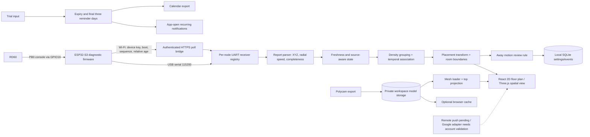

# Haven architecture and schema

The laptop runs the receiver and application service. A router does not run the sensing model. Transport supports local USB and a per-module HTTPS polling bridge for console previews. The Wi-Fi firmware has not been uploaded or validated on hardware; full radar binary decoding and CSI remain acquisition tasks.

## Data contracts

- **Home configuration:** `profile`, `homeName`, `rooms[]`, `modules[]`, `away`, `events[]`, `trials[]`. JSON persisted in SQLite. Local profile names are not authentication credentials.
- **Room:** `id`, `name`, `x`, `z`, `width`, `depth` in metres; `care` flag and optional model binding. On the 2D screen world Z is shown as floor-plan Y.
- **Module:** stable `id`, display name, `roomId`, world floor position `(x,z)`, mounting height, yaw in degrees and serial port. 0° points down the plan and 90° to its right.
- **Wi-Fi packet:** registered module ID, random boot identity, sequential packet number, relative log age and base64 raw bytes. This preserves diagnostic line boundaries without inventing radar measurement timestamps. The pairing key authorizes this module's transport only; stored credentials are SHA-256 digests.
- **Preview frame:** sequence, reported point count, coordinate rows, incomplete flag and live host receipt time. Radar measurement timestamps are not invented.
- **Coordinate:** radar XYZ in cm and signed radial velocity in cm/s. Convert to metres and m/s before applying placement transform. The unknown last console field is not confidence/SNR.
- **Track candidate:** cluster centroid, ID, observed association age, receipt time, bounded position trail. Neither an ID nor age establishes a human identity.
- **Event:** id, timestamp, room, rule reason, source `live|recorded`, acknowledged state. Review completion does not classify an intrusion.
- **Model asset:** id, source filename, constituent binary files, metres/unit scale and import time. Files are stored privately by the workspace service, with size/hash validation and authenticated retrieval. IndexedDB provides a local cache; device access still requires verified network/TLS deployment.
- **Trial:** id, name, actual start date, duration, renewal fee, repeat minutes, status and cancellation evidence reference. Status is Active Trial → Cancellation Pending → Cancelled & Verified. Pending continues reminders.

## Events and failure handling

- Each module has independent transport state, parser, bounded frames and logs. Exports and controls carry a module ID; tracking applies that module’s placement. Opening a serial port reserves one reader; a busy port is a visible failure rather than connection success.
- Firmware INFO and a real radar version reply are required before scanning. Existing safe finite scan configuration remains guarded by exact known firmware version.
- Live reports become unavailable when stale or disconnected. Zero points is a report result, not empty-room proof.
- A replay wrap or time gap resets temporal association. Changing data source disarms Away mode.
- Live Away rules run in a server thread and persist events even without the dashboard open; replay rules run in the dashboard and keep a recorded source. Finite scans limit monitoring duration.
- Away mode requires three consecutive reports with moving reflections before a local review event. It cannot distinguish people from other reflectors.
- Serial/API error messages are retained; stop acknowledgments are not fabricated. Firmware watchdog and service stop supplement finite frame count.
- Trial reminders use the actual expiry, not ambiguous day numbers. Repeated notifications stop only at verified cancellation. Closing the app currently stops desktop delivery; calendar reminders still follow calendar settings.
- Missing scan dependencies surface an import failure. A schematic fallback remains labeled as a schematic, not the user's house.
- Google API token refresh and retry/backoff adapters are implemented but not verified against an account. Remote-delivery acknowledgments are pending integration work; no successful cloud sync is shown without a response.
